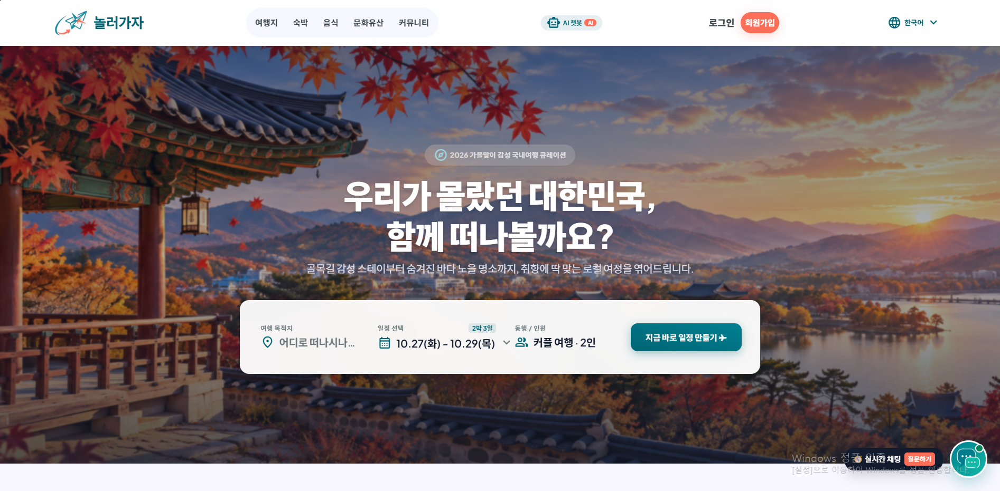
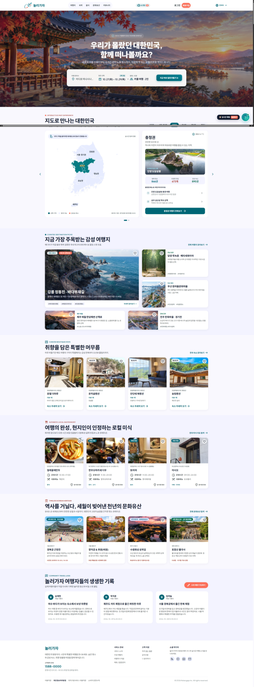
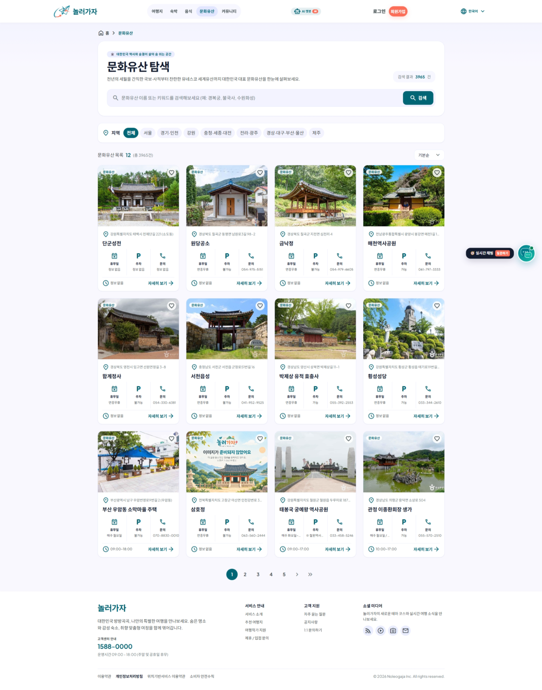
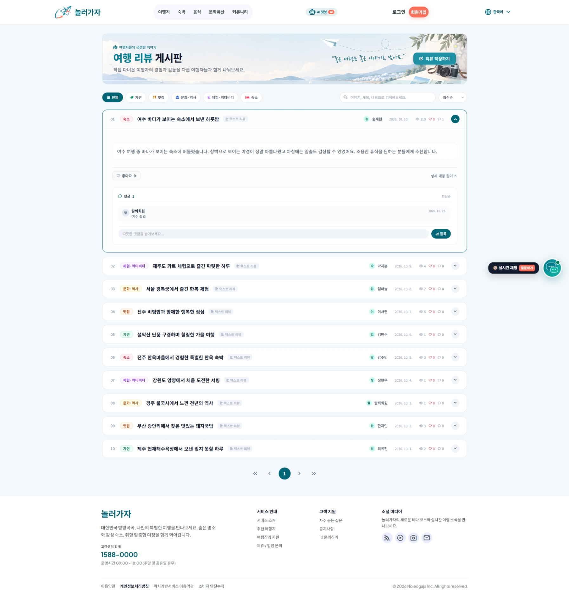
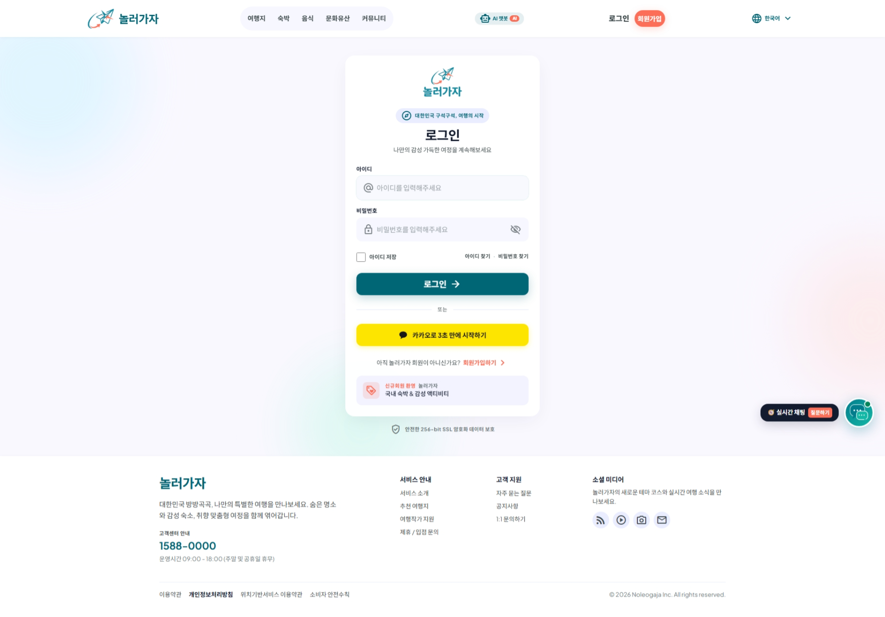
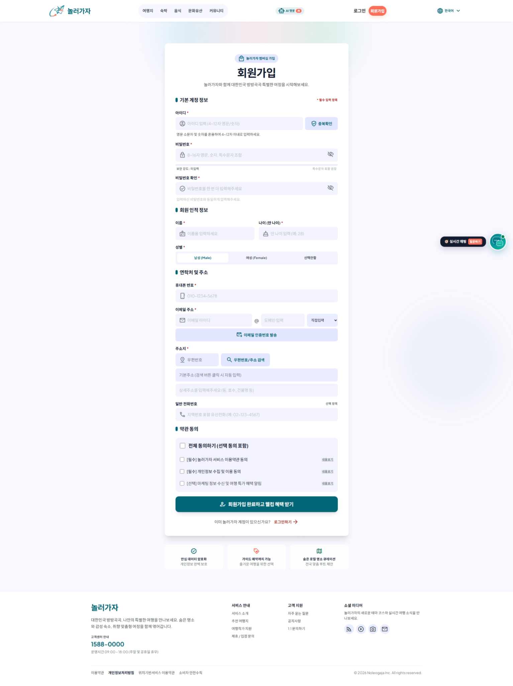

# Semi-Project_Travel
JSP/Servlet 기반의 국내 여행 정보 통합 플랫폼 | 여행지·숙박·맛집·문화유산 정보 제공 및 사용자 참여 기능 구현
<div align="center">

# ✈️ 놀러가자
### 국내 여행 정보 통합 웹 서비스

**여행지 탐색부터 문화유산·숙박·맛집·여행 후기까지 한곳에서**



</div>

## 📌 프로젝트 소개

**놀러가자**는 국내 여행을 준비하는 사용자가 여행지, 숙박, 음식점, 문화유산 정보를 탐색하고 여행 경험을 공유할 수 있도록 기획한 팀 프로젝트입니다. 공공데이터를 활용한 정보 조회와 회원 인증, 좋아요, 리뷰 게시판 등 사용자 참여 기능을 구현했습니다.

| 항목 | 내용 |
| --- | --- |
| 프로젝트 | 놀러가자 (국내 여행 정보 통합 서비스) |
| 형태 | 팀 세미프로젝트 |
| 개발 기간 | [실제 기간 입력] |
| 팀 구성 | [팀원 수 입력] |
| 나의 역할 | 메인 페이지 데이터 연동, 문화유산 조회 및 좋아요, 로그인·회원가입, 리뷰 게시판 관련 기능 |
| 저장소 | [GitHub 저장소 URL 입력] |

## 🛠 기술 스택

| 구분 | 기술 |
| --- | --- |
| Frontend | HTML, CSS, JavaScript, JSP, jQuery, AJAX |
| Backend | Java, Servlet, JDBC |
| Database | MySQL |
| Server | Apache Tomcat |
| External API | 한국관광공사 TourAPI, 카카오 로그인 API |
| Collaboration | Git, GitHub |

> 실제 프로젝트에서 사용한 기술만 남기고, 사용하지 않은 기술은 삭제해 주세요.

## 🖥️ 서비스 주요 화면

### 메인 페이지



- 여행지·숙박·음식점·문화유산·여행 후기 콘텐츠를 한 화면에서 탐색
- 각 콘텐츠에서 상세 페이지로 이동
- 사용자별 좋아요 상태 표시 기능 연동

### 문화유산 탐색 — 담당 기능



- TourAPI 데이터 수집 및 MySQL 저장·조회
- 지역별 필터, 키워드 검색, 정렬, 페이지 이동
- 문화유산 상세 정보와 좋아요 등록·취소
- 데이터가 없는 이미지 등 예외 상황에 대응하는 화면 처리

### 여행 리뷰 게시판 — 담당 기능



- 게시글 작성·조회·수정·삭제(CRUD)
- 이미지 업로드 및 조회, 댓글, 좋아요
- 로그인 사용자 및 작성자에 따른 권한 확인

### 로그인 — 담당 기능



- 일반 로그인 및 카카오 소셜 로그인
- 세션 기반 로그인 상태 관리
- 인증 정보를 사용하는 컨트롤러 간 세션키 일관성 개선

### 회원가입 — 담당 기능



- 아이디 중복 확인 및 입력값 검증
- 이메일 인증 등 회원 정보 검증 절차
- 회원 정보의 DB 저장 및 관리

## 👩‍💻 나의 구현 내용

### 1. 회원 인증 및 세션 관리

Servlet 기반으로 로그인·회원가입 기능을 구현하고, 카카오 로그인 연동 및 회원 상태 처리에 참여했습니다. 여러 컨트롤러에서 로그인 사용자를 일관되게 식별하도록 세션키 `loginId`를 통일했습니다.

### 2. 문화유산 데이터 연동

한국관광공사 TourAPI의 문화유산 데이터를 수집해 MySQL에 저장하고, 화면에서 검색·지역별 필터·정렬·좋아요 기능을 사용할 수 있도록 연결했습니다.

### 3. 리뷰 게시판

게시글 CRUD, 댓글, 이미지, 좋아요 기능을 구현하고 로그인 여부 및 작성자 권한을 고려해 데이터 변경을 처리했습니다.

### 4. 메인 페이지 연동

여러 카테고리의 데이터를 조회하여 메인 페이지 카드로 표시하고 관련 상세 화면으로 연결했습니다.

## 🧩 시스템 구조

```text
사용자 브라우저
    ↓ HTTP 요청
JSP / JavaScript
    ↓
Servlet Controller
    ↓
DAO (JDBC)
    ↓
MySQL

외부 TourAPI → 데이터 수집·저장 → MySQL → 문화유산 화면
```

> 실제 코드 구조에 맞춰 Service 계층 등 추가 요소가 있다면 보완해 주세요.

## 🔧 트러블슈팅

### 로그인 상태가 일부 기능에서 인식되지 않는 문제

- **문제:** 로그인 상태임에도 일부 좋아요 기능에서 비로그인으로 처리되는 현상이 발생했습니다.
- **원인:** 로그인 정보를 읽는 컨트롤러들이 서로 다른 세션키를 사용했습니다.
- **개선:** 로그인 사용자 식별에 사용하는 세션키를 `loginId`로 통일했습니다.
- **배운 점:** 여러 기능이 공유하는 인증 정보는 저장·조회 규칙을 일관되게 관리해야 합니다.

### 외부 API 요청 제한(HTTP 429)

- **문제:** 문화유산 데이터를 조회하는 과정에서 외부 API 요청 제한(HTTP 429) 오류가 발생하여 데이터 조회가 원활하지 않았습니다.
- **원인:** 페이지 조회 및 검색·정렬 기능 실행 시 외부 API를 반복 호출하면서 허용 요청 횟수를 초과했습니다.
- **대응:** Controller를 통해 외부 API에서 받아온 문화유산 데이터를 DB에 저장하고, 이후에는 API를 반복 호출하지 않고 DB에 저장된 데이터를 조회하도록 개선했습니다.
- **결과:** 외부 API 호출 횟수를 줄여 요청 제한 문제를 완화했으며, DB 기반으로 데이터를 조회하여 화면 출력 속도와 검색·정렬 기능의 응답 속도를 개선했습니다.

## 🌱 회고 및 개선 방향

- **배운 점:** JSP/Servlet 기반의 MVC 구조를 활용하여 Controller, Service, DAO, DB 간 데이터 처리 흐름을 이해했습니다. 외부 API 데이터를 DB와 연동하고, 검색·정렬·좋아요·리뷰 등의 기능을 구현하면서 데이터 관리와 사용자 경험의 중요성을 배웠습니다. 특히 API 호출 제한, 세션 관리, DB 관계 설정 등의 문제를 해결하며 오류의 원인을 분석하고 개선하는 경험을 쌓았습니다.

- **협업 경험:** Git 브랜치를 활용하여 팀원들과 기능을 분담하고 코드를 통합하는 과정을 경험했습니다. 특히 로그인 세션키가 서로 달라 발생한 오류를 해결하기 위해 `loginId`로 통일하면서 공통 규칙과 코드 일관성의 중요성을 깨달았습니다. 또한 기능 간 데이터 연결과 DB 구조를 정리하며 협업 과정에서의 소통과 책임감을 배웠습니다.

- **향후 개선:** 외부 API 호출에 대한 캐싱 및 예외 처리 기능을 강화하고, DB 조회 성능 개선을 위해 쿼리 최적화와 인덱스 적용을 검토할 계획입니다. 또한 JUnit과 GitHub Actions를 활용한 자동화 테스트를 도입하고, 모바일 반응형 UI와 접근성을 개선하여 서비스의 안정성과 사용 편의성을 높이고자 합니다.

